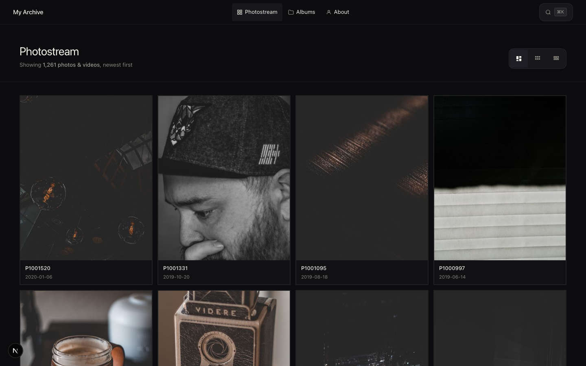
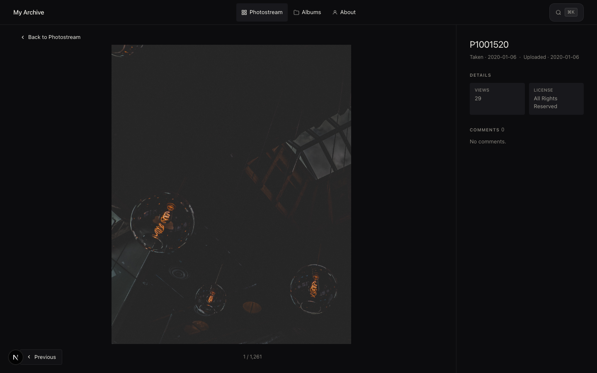
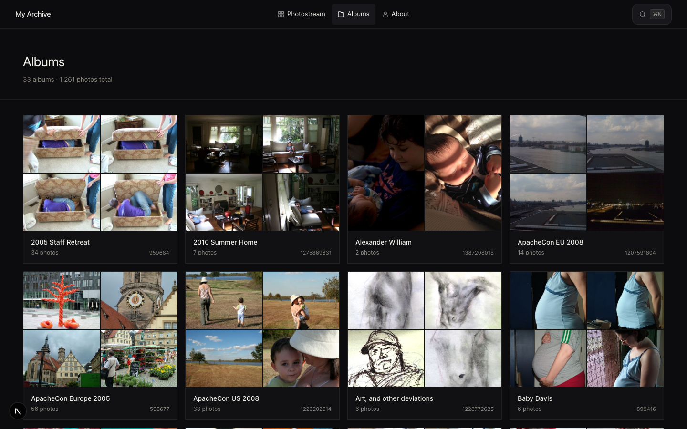
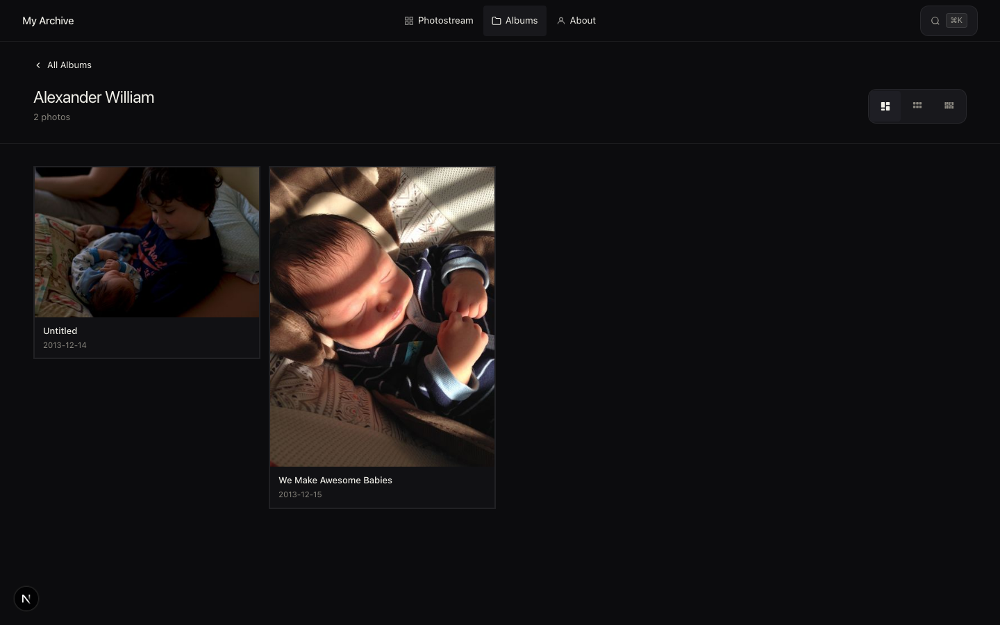
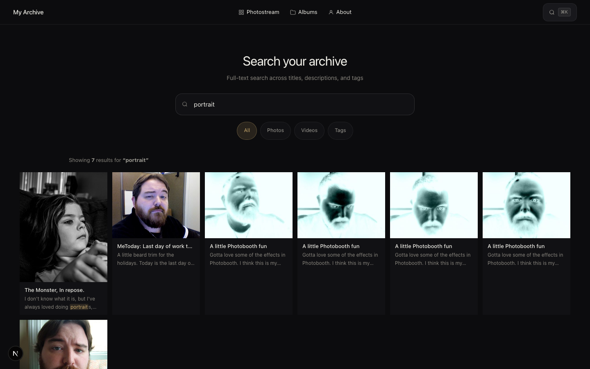
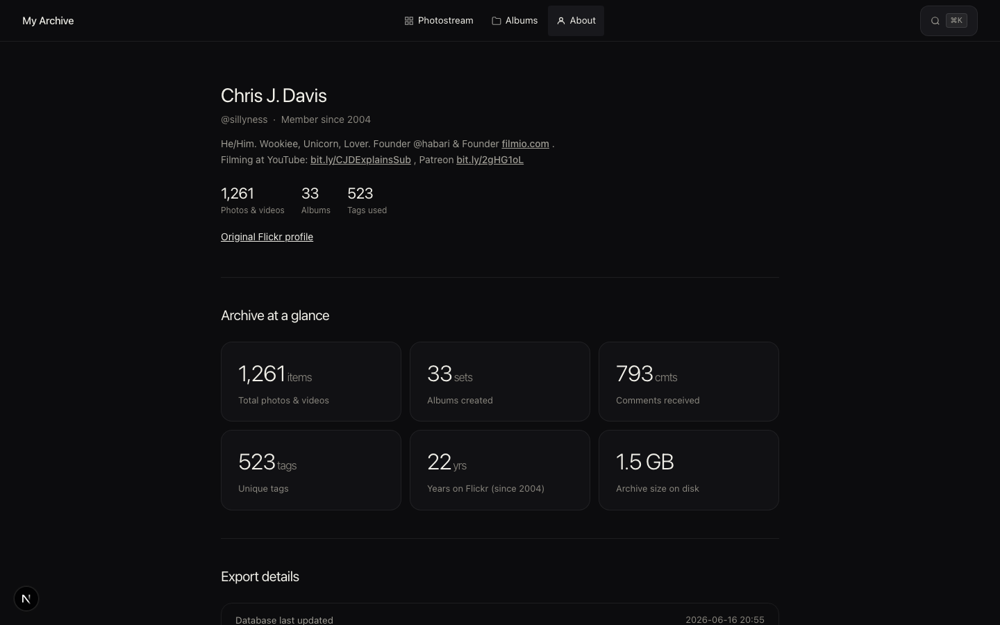
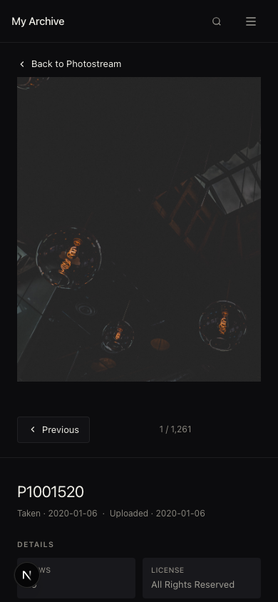

# Flickr Archive

Browse your exported Flickr data locally after leaving Flickr. Import your ZIP export once, then explore your photostream, albums, comments, and tags in a clean read-only web UI.

## Screenshots

**Photostream** — date-sorted photo grid (newest first, left to right by row) with adjustable columns.



**Photo detail** — full-size image with metadata, tags, and comments.



**Albums** — cover previews for every album in your export.



**Album view** — photos in Flickr album order.



**Search** — full-text search across titles, descriptions, and tags.



**About** — archive stats and imported profile info.



**Mobile** — photo detail on a phone-sized viewport.



## Requirements

- Node.js 20+
- A Flickr data export (metadata `*_part1.zip` + `data-download-*.zip` files)

## Quick start

```bash
npm install
cp .env.example .env

# Option A: import in the browser
npm run dev
# Open http://localhost:3000/import

# Option B: import via CLI
npm run import -- /path/to/flickr-export
npm run dev
```

Open [http://localhost:3000](http://localhost:3000).

## Import

### In the app

Go to [http://localhost:3000/import](http://localhost:3000/import) while the dev server is running and upload your Flickr export ZIP files (`*_part1.zip` and `data-download-*.zip`).

### CLI

```bash
npm run import -- /path/to/flickr-export [--output ./archive] [--force]
```

| Flag | Description |
|------|-------------|
| `--output`, `-o` | Archive output directory (default: `./archive`) |
| `--force`, `-f` | Re-import: clears existing media, thumbs, and database |

The import pipeline:

1. Extracts metadata JSON and original media files from your ZIPs
2. Matches `photo_<id>.json` metadata to `*_<id>_o.<ext>` media files
3. Generates JPEG thumbnails for images
4. Builds a SQLite index with FTS5 search over titles, descriptions, and tags

Output layout:

```
archive/
├── index.sqlite
├── media/     # original files from Flickr
└── thumbs/    # generated thumbnails
```

## Environment

```
FLICKR_ARCHIVE_PATH=./archive
ARCHIVE_STORAGE=local
BLOB_PUBLIC_BASE_URL=
BLOB_ARCHIVE_PREFIX=flickr-archive
BLOB_READ_WRITE_TOKEN=
IMPORT_ENABLED=false
IMPORT_SECRET=
TRUST_PROXY=false
```

| Variable | Description |
|----------|-------------|
| `FLICKR_ARCHIVE_PATH` | Archive output directory (default: `./archive`) |
| `ARCHIVE_STORAGE` | `local` (default) or `blob` for Vercel Blob-backed media + SQLite |
| `BLOB_PUBLIC_BASE_URL` | Public base URL printed by `npm run upload:blob` |
| `BLOB_ARCHIVE_PREFIX` | Pathname prefix in the Blob store (default `flickr-archive`) |
| `BLOB_READ_WRITE_TOKEN` | Vercel Blob token — required for `upload:blob` |
| `IMPORT_ENABLED` | Web import switch. **Production is opt-in:** unset/false keeps import off. Always disabled on Vercel. Local/dev defaults to enabled when unset. |
| `IMPORT_SECRET` | Required in production when `IMPORT_ENABLED=true` on a disk host. |
| `TRUST_PROXY` | Set `true` only behind a reverse proxy that overwrites `X-Forwarded-For` / `X-Real-IP`. |

For local development, leave `IMPORT_SECRET` unset and import works without a password. **Production leaves web import off unless you set `IMPORT_ENABLED=true` and `IMPORT_SECRET`.** After importing, set `IMPORT_ENABLED=false` (or omit it) and restart. CLI import (`npm run import`) still works over SSH regardless of this setting.

## Deploy on Vercel

Vercel has **no persistent disk**. The photostream cannot use a local `./archive` on the server. Instead:

1. Import on your machine (CLI or local `/import`)
2. Upload `archive/` to **Vercel Blob**
3. Point the deployed app at that Blob store with env vars

Web import (`/import`) is **always disabled** on Vercel (`VERCEL=1`). Do not set `IMPORT_ENABLED=true` there.

### 1. Connect the Git branch

In the Vercel project:

1. **Settings → Environments → Production**
2. Under **Branch Tracking**, set the branch (e.g. `vercel-support` or `main`)
3. Save

Pushes to that branch become Production deployments. (The older **Settings → Git → Production Branch** control may not appear in newer dashboards.)

### 2. Create a Blob store

1. Vercel project → **Storage** → create a **Blob** store
2. Copy `BLOB_READ_WRITE_TOKEN` into a local `.env.local` (never commit it)

### 3. Import locally, then upload

```bash
# Build the archive on disk (once)
npm run import -- /path/to/flickr-export

# Upload media/, thumbs/, and index.sqlite to Blob
export BLOB_READ_WRITE_TOKEN=vercel_blob_rw_...
npm run upload:blob          # optional: --dry-run first
```

The script prints the exact env values to set, including `BLOB_PUBLIC_BASE_URL`.

Expected URL shape (no trailing slash):

```text
https://<store-id>.public.blob.vercel-storage.com/flickr-archive
```

That base must include the `/flickr-archive` prefix (or whatever you set as `BLOB_ARCHIVE_PREFIX`). The app loads SQLite from `{BLOB_PUBLIC_BASE_URL}/index.sqlite` and images from `{BLOB_PUBLIC_BASE_URL}/media/...` and `.../thumbs/...`.

Re-run `npm run upload:blob` after a local re-import; uploads use `allowOverwrite`.

### 4. Set Production env vars and redeploy

In **Settings → Environment Variables** (Production), set:

| Variable | Required | Value |
|----------|----------|--------|
| `ARCHIVE_STORAGE` | **yes** | `blob` (must not be `local`) |
| `BLOB_PUBLIC_BASE_URL` | **yes** | exact URL printed by `upload:blob` |
| `BLOB_ARCHIVE_PREFIX` | if non-default | must match the upload prefix (default `flickr-archive`) |
| `BLOB_READ_WRITE_TOKEN` | optional at runtime | only needed again for re-uploads from CI/local |

Do **not** rely on `FLICKR_ARCHIVE_PATH` on Vercel. Leave `IMPORT_ENABLED` unset/false.

**Redeploy after changing env vars** (or push a new commit). Env changes do not apply to an already-running deployment until it rebuilds.

### 5. Verify

- Home page shows the photostream (not “Archive not imported”)
- **About** shows Storage: **Vercel Blob**
- Thumb URLs look like `https://….public.blob.vercel-storage.com/flickr-archive/thumbs/….jpg`

### Troubleshooting: “Archive not imported” on Vercel

That screen means the app could not download `index.sqlite` from Blob (or is still in local-disk mode).

| Check | What to look for |
|-------|------------------|
| `ARCHIVE_STORAGE` | Must be `blob`. If set to `local` (e.g. copied from `.env.example`), Vercel ignores Blob and looks for `./archive` on disk. |
| `BLOB_PUBLIC_BASE_URL` | Must include the prefix, e.g. `…/flickr-archive`, not only the store hostname. |
| Blob object exists | Open `{BLOB_PUBLIC_BASE_URL}/index.sqlite` in a browser; it should download (public). |
| Redeploy | Confirm the latest Production deployment was built **after** the env vars were saved. |
| Branch | Confirm Production branch tracking matches the branch you pushed. |

Optional dry-run before a long upload:

```bash
npm run upload:blob -- --dry-run
```

### Public hosting

This app is a **public photostream**: pages and media URLs are unauthenticated by design. Do not host private photos on a public URL.

Hardening checklist:

1. Keep web import off on public hosts (always off on Vercel; use CLI + `upload:blob`).
2. On a VPS, if you must use web import briefly, set a long random `IMPORT_SECRET`, then disable import again.
3. Terminate TLS at a reverse proxy (or use Vercel HTTPS); the app sends HSTS in production.
4. On a VPS, set proxy body-size limits and `TRUST_PROXY=true` only when the proxy strips/overwrites forwarded IP headers.

### Security notes

- Upload size is capped at 2 GiB per file and 10 GiB per session (see `src/lib/import-limits.ts`).
- ZIP extraction validates paths and limits uncompressed size to prevent zip-slip and zip bombs.
- Import password, upload, and import-start attempts are rate-limited per IP.
- Import sessions use short-lived HMAC-signed cookies (24h), not a static hash of the password.
- Place a reverse proxy body size limit in front of the app for defense in depth (VPS).

## Routes

| Route | Description |
|-------|-------------|
| `/` | Photostream (newest first, paginated) |
| `/photos/[id]` | Photo detail with tags and comments |
| `/albums` | Album list |
| `/albums/[id]` | Album grid |
| `/search?q=` | Full-text search |
| `/about` | Imported profile and stats |
| `/import` | Upload Flickr export ZIPs |

## Scripts

```bash
npm run dev          # Start dev server
npm run build        # Production build
npm run start        # Start production server
npm run import       # Import Flickr export (local disk)
npm run upload:blob  # Upload local archive/ to Vercel Blob
npm run test         # Run tests
npm run typecheck    # TypeScript check
```

## Testing

```bash
npm test
```

Tests cover photo ID matching, JSON parsing, a full mini-import fixture, and import-auth / rate-limit hardening.

## What's not included (Week 1)

- Public user authentication
- Map/geotags, groups, contacts, Flickr Mail
- EXIF panel
- Static export / Docker
- In-browser import on Vercel (use local import + `upload:blob`)

## License

Apache License 2.0. See [LICENSE](LICENSE).
